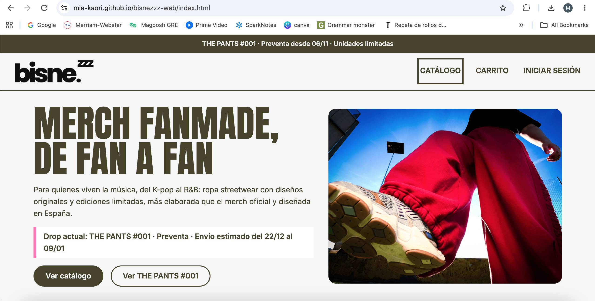
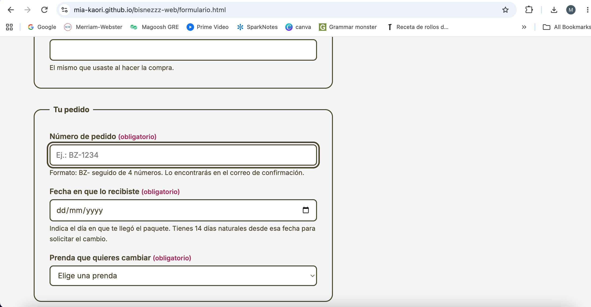
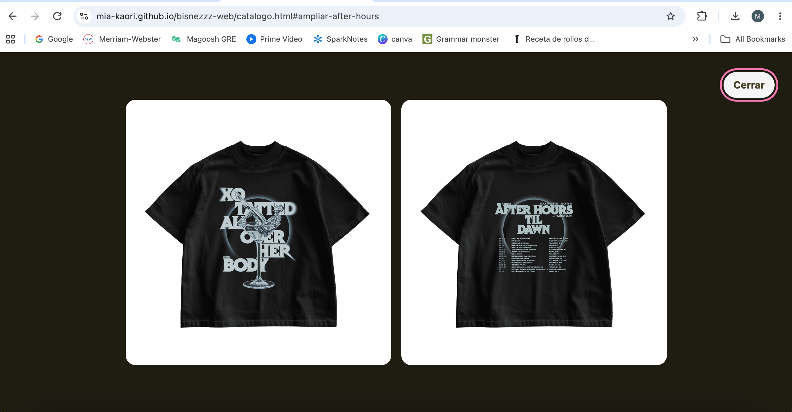
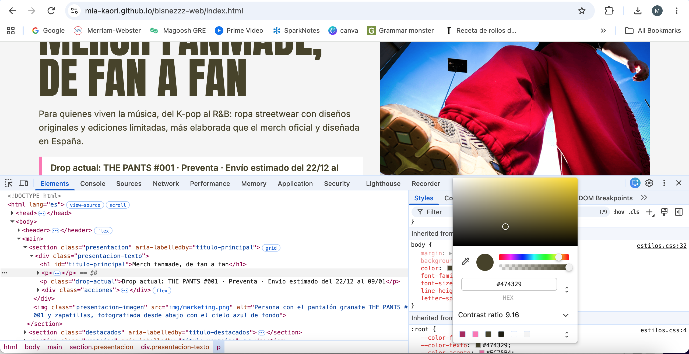
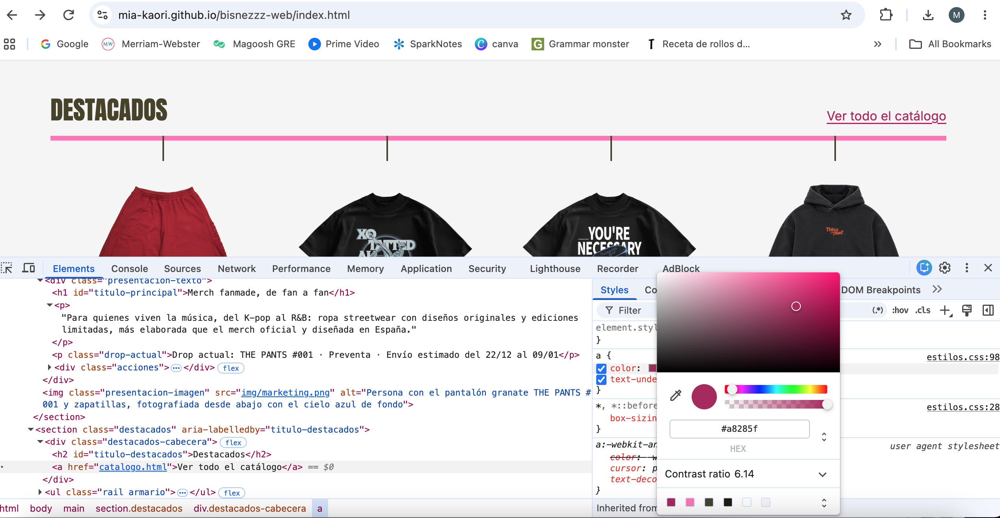
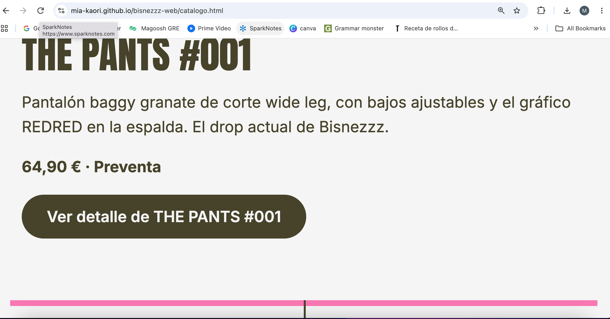
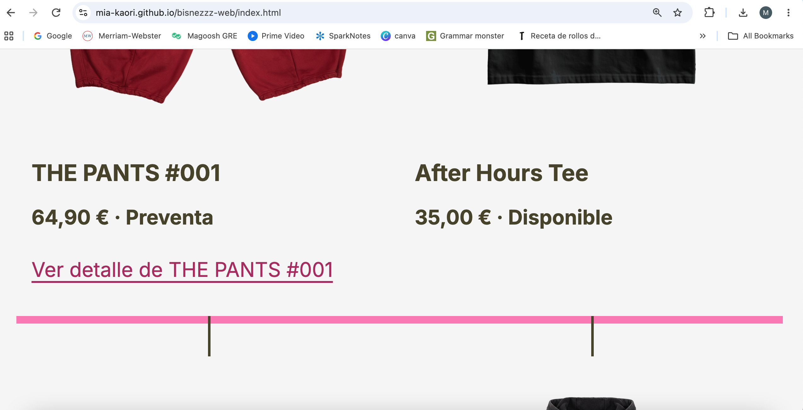

# Comprobación de accesibilidad

Revisión de las seis páginas: `index.html`, `catalogo.html`, `detalle.html`, `carrito.html`, `formulario.html` y `login.html`.

> Esta revisión es **parcial**: comprueba los aspectos que pide la práctica, pero no permite afirmar que la web cumple las pautas WCAG en los niveles A, AA o AAA.

**Herramientas:** navegación solo con teclado (Tab, Mayús + Tab, Enter, Espacio y flechas), DevTools de Chrome (inspector, selector de color y modo adaptable), WebAIM Contrast Checker, validador del W3C (HTML y CSS) y zoom del navegador al 200 %. Las capturas están en `docs/capturas/`.

## Tabla de comprobación

| Aspecto | Página o elemento revisado | Método utilizado | Resultado | Corrección realizada o problema pendiente |
|---|---|---|---|---|
| Estructura: idioma | Las 6 páginas | Revisión del código | Todas tienen `<html lang="es">`. | — |
| Estructura: título | Las 6 páginas | Revisión del código y pestaña del navegador | Títulos descriptivos y distintos: «Bisnezzz · Merch fanmade de música», «Catálogo · Bisnezzz», «THE PANTS #001 · Bisnezzz», «Carrito · Bisnezzz», «Solicitar cambio de talla · Bisnezzz» e «Iniciar sesión · Bisnezzz». | — |
| Estructura: encabezados | Las 6 páginas | Revisión del código | Un único `h1` por página y niveles sin saltos (`h1` → `h2` → `h3`). Regiones con `header`, `nav`, `main`, `footer`, `section`, `article` y `aside`. | En el carrito, la frase «Tu outfit se está cocinando» es un párrafo destacado, no un encabezado, para no romper la jerarquía. |
| Estructura: validación | Las 6 páginas y `estilos.css` | Validador del W3C | Sin errores. | — |
| Imágenes | Catálogo, inicio y detalle | Revisión de los `alt` | Cada foto de producto describe la prenda, el diseño y si es la vista delantera o trasera. El logo describe su función: «Bisnezzz, ir al inicio». | Las fotos de la vista ampliada del catálogo tenían la espalda con `alt=""`. Ahora que se ve, tiene su descripción. |
| Imágenes decorativas | Carrito | Revisión del código | Las miniaturas tienen `alt=""` porque el nombre de la prenda aparece justo al lado, en un `h3`. | — |
| Formularios: etiquetas | Formulario, login, buscador y filtros | Revisión del código y clic en cada etiqueta | Todas las etiquetas son visibles y están asociadas (`for`/`id`, o el control dentro del `label`). Al hacer clic en una etiqueta se activa su campo. El *placeholder* solo se usa como ejemplo. | — |
| Formularios: agrupaciones | Formulario, filtros y selector de talla | Revisión del código | `fieldset` y `legend` en «Tus datos», «Tu pedido», «El cambio», «Motivo del cambio», «Artista» y «Elige tu talla». | — |
| Formularios: instrucciones | Formulario | Revisión del código y prueba de envío vacío | Obligatorios marcados con el texto «(obligatorio)» y opcionales con «(opcional)». Instrucciones de formato asociadas con `aria-describedby`. La validación nativa avisa de los campos vacíos o mal escritos. | En el detalle, la talla y la casilla de preventa decían «(obligatoria)» sin serlo. Se cambió a «Elige tu talla» y se quitó «(obligatorio)» de la casilla. |
| Teclado | Las 6 páginas | Recorrido con Tab, Enter, Espacio y flechas | Se llega a todos los enlaces, botones y campos, y se pueden usar. Los desplegables `details` se abren con Enter. No hay trampas de teclado. | **Corregido:** en la foto ampliada del catálogo, el Tab llevaba el foco detrás de la foto, a la paginación. Ahora, mientras está abierta, el resto de la página se oculta con `visibility: hidden` y el foco solo puede ir a «Cerrar». |
| Orden del foco | Inicio y formulario | Recorrido con Tab | Orden lógico: logo → menú → contenido → pie. En el formulario: nombre → correo → pedido → fecha → prenda → motivo → talla → comentarios → casilla → botón. | — |
| Foco visible | Las 6 páginas | Recorrido con Tab | Contorno de 3 px con separación de 3 px (`:focus-visible`) en el color del texto. En el pie y en la foto ampliada, en rosa, para que se vea sobre el fondo oscuro. | — |
| Contraste: texto | Texto general | Selector de color de DevTools | #474329 sobre #F5F5F5: **9,16:1** | — |
| Contraste: enlaces y obligatorios | Enlaces, «(obligatorio)» | Selector de color de DevTools | #A8285F sobre #F5F5F5: **6,14:1** · sobre #FFFFFF: **6,7:1** | El rosa claro (#FC75B4) nunca se usa para texto pequeño sobre fondo claro. |
| Contraste: botones | Botón principal y su `:hover` | WebAIM Contrast Checker | #F5F5F5 sobre #474329: **9,16:1** · sobre #A8285F (`:hover`): **6,14:1** | — |
| Contraste: pie | Títulos del pie | WebAIM Contrast Checker | #FC75B4 sobre #474329: **3,97:1**. Es texto grande (24 px o más), así que el mínimo es 3:1. | — |
| Contraste: página actual | Subrayado del menú | WebAIM Contrast Checker | El rosa claro sobre #F5F5F5 daba **2,31:1** y casi no se veía. | **Corregido:** ahora es #A8285F, con **6,14:1**. |
| Uso del color | Paginación | Revisión visual | La página actual solo se distinguía por el color de fondo, igual que al pasar el ratón. | **Corregido:** la página actual también lleva subrayado grueso. |
| Uso del color | Menú, precios, estados y formularios | Revisión visual | Página actual del menú con subrayado y negrita. Precio rebajado explicado en texto, no solo tachado. Estado «Preventa» o «Disponible» escrito. Obligatorios indicados con texto. | — |
| Ampliación al 200 % | Las 6 páginas | Zoom del navegador al 200 % sobre una ventana de 1024 px | Todo el contenido y los controles siguen disponibles, sin desplazamiento horizontal de la página, recortes ni superposiciones. Las columnas pasan a una sola. | **Corregido:** en el inicio, el rail de destacados obligaba a desplazarse en horizontal dentro del rail para ver las dos últimas prendas, que no se alcanzaban con el teclado. Ahora, al ampliar, las prendas pasan a la línea siguiente (`flex-wrap: wrap`). |
| Movimiento | Efectos de las fotos | Revisión del código | Las transiciones y el zoom se desactivan si el usuario tiene activado «reducir movimiento» (`prefers-reduced-motion`). | — |

## Problemas aceptados

- **Vista trasera de los destacados 2, 3 y 4 del inicio:** el cambio de foto al pasar el ratón no se ve con el teclado, porque esas prendas no tienen página de detalle y no se puede poner un enlace sin destino. La información no se pierde: el `alt` de la foto trasera la describe y la foto se ve ampliada desde el catálogo.

## Evidencias

### Teclado y foco visible

Foco en el menú principal (inicio):

Foco en un campo del formulario:

Foto ampliada del catálogo con el foco en «Cerrar»:

### Contraste

Texto general, #474329 sobre #F5F5F5 (9,16:1):

Enlaces, #A8285F sobre #F5F5F5 (6,14:1):

### Ampliación al 200 %

Catálogo:

Inicio, sección Destacados:

