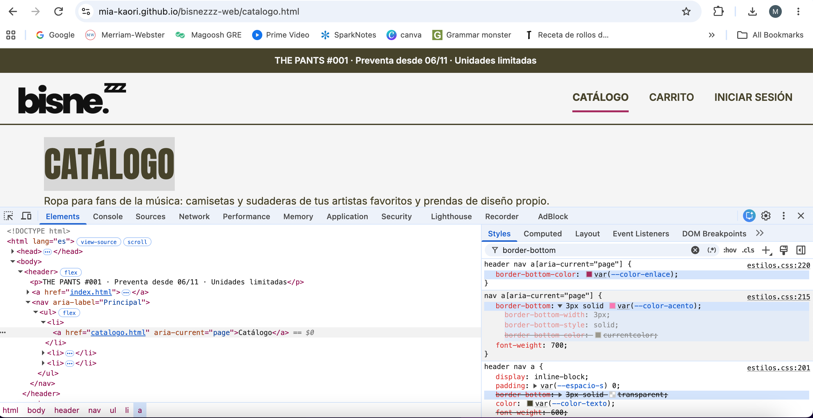
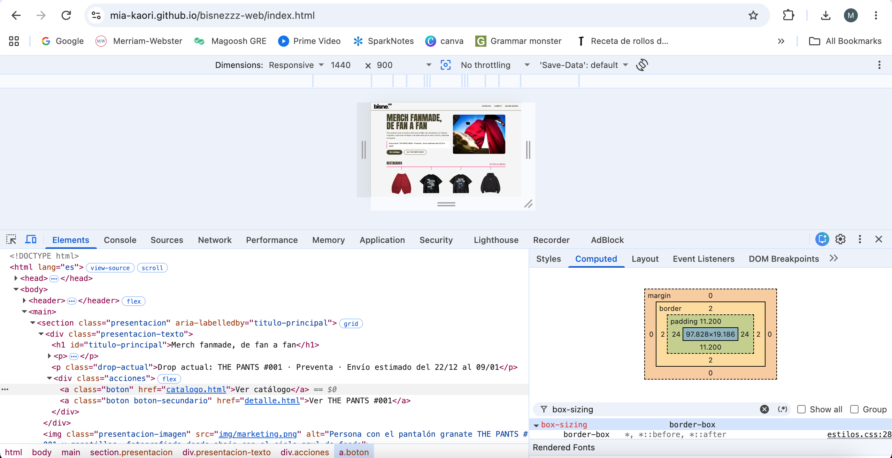
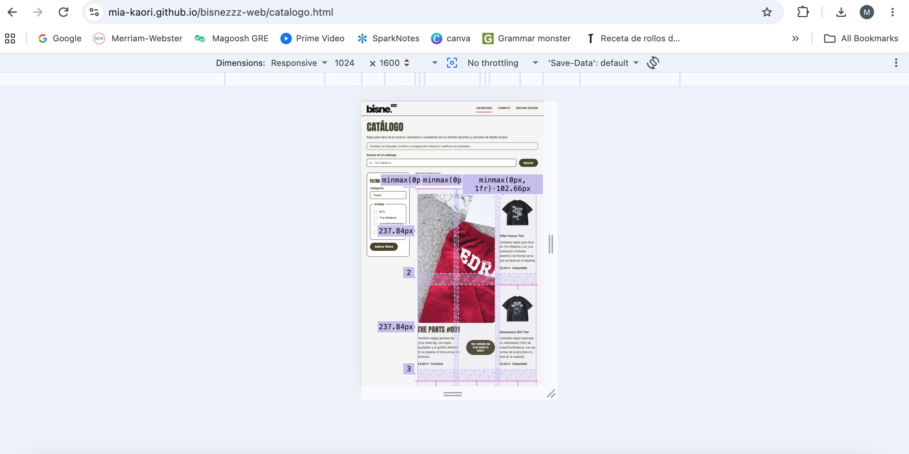

# Comprobaciones con DevTools

Herramienta: DevTools de Google Chrome (clic derecho → *Inspeccionar*). Las capturas están en `docs/capturas/`.

## 1. Regla sobrescrita por la cascada: página actual del menú

**Elemento:** enlace «Catálogo» del menú principal en `catalogo.html` (`<a href="catalogo.html" aria-current="page">`).

**Qué se comprueba:** qué color de subrayado (`border-bottom-color`) se aplica finalmente, porque tres reglas compiten por esa propiedad:

| Regla | Especificidad | Valor | Resultado |
|---|---|---|---|
| `header nav a` | 0,0,3 | `border-bottom: 3px solid transparent` | Tachada entera |
| `nav a[aria-current="page"]` | 0,1,2 | `border-bottom: 3px solid var(--color-acento)` (#FC75B4) | Se aplican el grosor y el estilo; el color queda sobrescrito |
| `header nav a[aria-current="page"]` | 0,1,3 | `border-bottom-color: var(--color-enlace)` (#A8285F) | **Se aplica** |

**Valor final (pestaña *Computed*):** `border-bottom-color: rgb(168, 40, 95)`.

**Explicación:** gana la regla más específica. `border-bottom` es una propiedad abreviada que agrupa grosor, estilo y color. La regla más específica solo cambia el color, así que el grosor (3px) y el estilo (`solid`) siguen llegando de `nav a[aria-current="page"]`. En el mismo panel se ve otro ejemplo de cascada: `font-weight: 600` de `header nav a` aparece tachado porque lo sobrescribe `font-weight: 700`. `nav a[aria-current="page"]` vale para la cabecera y para el pie. En la cabecera, el rosa claro tenía un contraste de solo 2,31:1 con el fondo, así que se añadió `header nav a[aria-current="page"]`, más específica, para usar el rosa oscuro (6,14:1). En el pie, sobre fondo oscuro, se mantiene el rosa claro.

## 2. Modelo de caja: botón «Ver catálogo»

**Elemento:** `<a class="boton" href="catalogo.html">` en la portada (`index.html`), a 1440 px.

| Parte | Valor | Origen |
|---|---|---|
| Contenido | 97,83 × 19,19 px | El ancho depende del texto; el alto, de `font: 600 1rem/1.2` |
| Relleno (*padding*) | 11,2 px arriba y abajo, 24 px a los lados | `padding: 0.7rem 1.5rem` |
| Borde | 2 px | `border: var(--borde)` |
| Margen | 0 | — |
| **Tamaño total** | **149,8 × 45,6 px** | — |

**Explicación:** con `box-sizing: border-box` (aplicado a todos los elementos en el *reset*), el relleno y el borde están incluidos en el tamaño de la caja. El ancho total es 97,83 + 24 × 2 + 2 × 2 = 149,8 px, y el alto, 19,19 + 11,2 × 2 + 2 × 2 = 45,6 px, por encima del `min-height: 2.75rem` (44 px). Ese mínimo asegura una zona de clic cómoda (ley de Fitts) y, como es un mínimo y no una altura fija, el botón crece si el texto ocupa dos líneas.

## 3. Distribución Grid: catálogo

**Elemento:** `<ul class="catalogo-grid armario">` en `catalogo.html`, con la superposición de Grid activada (insignia `grid` en el panel *Elements*).

| Propiedad | 1440 px | 1024 px |
|---|---|---|
| Columnas (`repeat(3, minmax(0, 1fr))`) | 264 px × 3 | 205 px × 3 |
| Separación (`gap`) | 64 px entre filas, 24 px entre columnas | igual |
| Filas | automáticas: crecen con su contenido | igual |
| Ficha destacada (`grid-column: span 2; grid-row: span 2`) | 552 × 1107 px | — |

**Qué se comprueba:**
- La ficha de THE PANTS #001 ocupa 2 columnas y 2 filas. Las otras 8 fichas rellenan los huecos sin alterar el orden de lectura.
- Las filas no tienen altura fija: la segunda mide más que las demás porque una descripción es más larga.
- No hay desplazamiento horizontal ni recortes en ninguna de las dos anchuras.

**Corrección realizada:** al inspeccionar el grid se vio que la barra rosa del «perchero» (`.armario > li::before`) sobresalía 12 px por los lados de la cuadrícula. En el rail de la portada, ese exceso creaba además una barra de desplazamiento horizontal a 1024 y 1440 px. Se corrigió añadiendo `padding-inline: calc(var(--hueco-grid) / 2)` al contenedor `.armario`, para que la barra termine justo en su borde.

La captura está hecha a 1024 × 1600 px. Para que cupiera la cuadrícula entera, el modo adaptable redujo la vista al 50 %, y DevTools muestra las medidas multiplicadas por ese zoom. Por eso las etiquetas indican la mitad del tamaño real:

| Etiqueta en la captura | Tamaño real |
|---|---|
| `minmax(0px, 1fr) · 102.66px` (cada columna) | 205,33 px |
| `237.84px` (cada fila de la ficha destacada) | 475,68 px |

La etiqueta `minmax(0px, 1fr)` confirma que las columnas son flexibles: se reparten el espacio disponible a partes iguales. La ficha de THE PANTS #001 va de la línea de columna 1 a la 3 y de la línea de fila 1 a la 3, es decir, ocupa 2 columnas y 2 filas.
